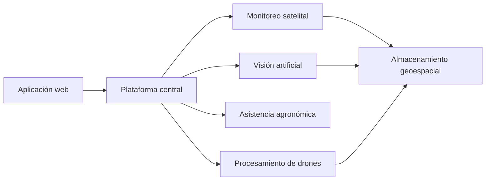

  

  # AgroTabX

  ### Más claridad para decidir. Más tecnología para producir.

  **Agricultura de precisión · Inteligencia agronómica · Gestión productiva**

---

## Tecnología pensada desde el campo

AgroTabX es una iniciativa AgTech que integra información satelital, vuelos con drones y registros de campo para acompañar a productores y equipos técnicos en la gestión de sus cultivos.

Convertimos datos dispersos en una visión más clara de cada lote y de cada campaña, para ayudar a planificar el trabajo, priorizar recorridas y tomar decisiones con mejor información.

## Una plataforma, distintas perspectivas

|  | Qué aporta |
| :---: | :--- |
| **Observación satelital** | Seguimiento del vigor de los cultivos e identificación de zonas que necesitan atención. |
| **Drones y cartografía** | Mapas detallados, ortomosaicos y modelos del terreno a partir de vuelos. |
| **Análisis de imágenes** | Herramientas de visión artificial para apoyar el conteo de plantas y la detección de malezas. |
| **Asistencia agronómica** | Registro de novedades por voz y síntesis de información para el seguimiento del campo. |
| **Gestión productiva** | Organización de lotes, labores, equipos de trabajo, costos y procesos agroindustriales. |

## Así se ve AgroTabX

Una experiencia que lleva la información del lote a la planificación cotidiana.

  
  Monitoreo de precisión y cartografía aérea.

 

  
  Vista ilustrativa del tablero. La información mostrada es de ejemplo.

## Del dato a la decisión

La aplicación web se conecta con una plataforma central que coordina herramientas especializadas. Los resultados satelitales, visuales y de procesamiento de vuelos se reúnen en el almacenamiento geoespacial para apoyar la planificación y el seguimiento de cada campaña.

## Nuestra visión

Queremos que la tecnología avanzada sea práctica y accesible para quienes producen. Por eso, ponemos el foco en información comprensible, herramientas útiles para el trabajo diario y una producción más eficiente y sostenible.

## Fundador

**[Duilio Mamani](https://github.com/duiliomamani)** fundó AgroTabX con la visión de acercar la tecnología, los datos geoespaciales y la inteligencia artificial a los desafíos cotidianos de la producción agrícola.

---

  

  **AgroTabX** · Tecnología y conocimiento para el futuro del campo.

